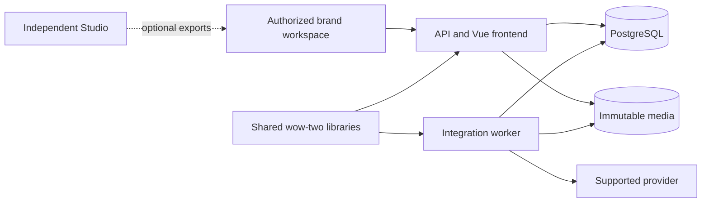

# Architecture

*Last updated: 2026-09-26*

## Product and runtime boundaries

One platform repository owns the API/frontend, integration worker, and product modules. They share
a versioned release contract and initially a PostgreSQL database. Studio is a separate creative product.
There is no separate repository or microservice for each calendar, approval, or observation feature.

## Initial module ownership

| Module | Owned state and behavior |
|---|---|
| Organizations and brands | Membership, roles, brand configuration, authorization context |
| Source references and media | Imported facts, immutable revisions, provenance, storage policy |
| Content and approvals | Draft revisions, destination variants, review, approval/revocation |
| Connections | Provider account authority, capabilities, credential references, lifecycle |
| Publications | Scheduled intent, attempts, receipts, cancellation, reconciliation |
| Observations | Source-preserving metrics, availability/freshness, optional enquiry evidence |

Infrastructure primitives and reusable brand behavior are separate concerns. Existing SDK defects
are fixed in their owner. New reusable behavior is proven through the product, then completed and
adopted through the shared-library cycle. Product modules must not depend on Ocharo constants.

## Invariants

- Authenticate the human and resolve organization membership before ordinary reads or writes.
- Fail closed on missing or mismatched tenant context, including workers and object storage.
- Preserve canonical product/media identities and immutable approved content revisions.
- Commit delivery intent and the outbox event together; jobs carry record IDs/revisions.
- Use short claims; do not retain database locks through provider calls.
- Reconcile an uncertain external effect before attempting another potentially duplicate send.
- Distinguish provider acceptance, processing, confirmed publication, and manual handoff.
- Keep secrets out of job arguments, browser bundles, exports, logs, and version control.
- Retain native metric definitions and freshness; missing observations never silently become zero.
- Let one owner coordinate migrations, solution files, dependency pins, and runtime composition.

## Studio and source records

Studio JSON is imported unchanged, with platform association in a sidecar record. No database sharing
or direct cross-repository project reference is required. Existing source product records and media
remain canonical until a deliberate ownership migration.

The detailed [build contract][design] remains the analysis source. Its framework examples are subject
to the current shared Vue frontend standard, recorded in this repository's template audit.

[design]: /Users/max/Projects/10x-ws/workbench/fam/mft-10x-ws/context/domains/external/work/ventures/ocharo/platform/och-platform-content-publishing-build.md
