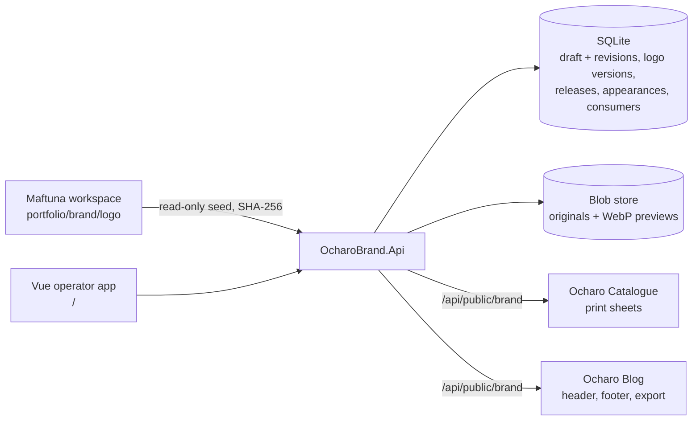

# ventures.ocharo-brand — Architecture

*Last updated: 2026-10-19*

| Project | Responsibility |
|---|---|
| `OcharoBrand.Api` | Admin + public controllers, local-pilot boundary (loopback, no cross-origin writes, CORS on `/api/public`), ProblemDetails mapping, seed-on-empty |
| `OcharoBrand.Application` | `BrandService` (identity, logo versions, publish with diff, appearances), `PublicBrandService` (kit build, logo fallbacks, tokens CSS, consumer tracking) |
| `OcharoBrand.Domain` | `BrandDraft`, `BrandIdentity` (localized text, palette, typography, links), `LogoVersion`, `BrandRelease`, `BrandAppearance`, records |
| `OcharoBrand.Infrastructure` | `MediaStore` (kit `IBlobRepository`, SkiaSharp WebP previews), `BrandSeeder` |
| `OcharoBrand.Persistence` | EF Core SQLite; draft saves check the expected revision and write a snapshot |

## Contracts

- `GET /api/public/brand?locale=uz|ru|en&app={name}` — latest release plus any active appearance: `{ name, spellingRule, release, publishedAt, locale, descriptor, tagline, location, descriptors, palette[], typography, links[], logos{slot: {url, fileUrl, previewUrl, contentType, width, height, sha256, fromAppearance}}, appearance }`; cached 60 s.
- Cache lifetimes of the kit, stable logo URLs and tokens are capped at the next appearance start/end, so no cache outlives a scheduled change.
- `GET /api/public/brand/releases/{n}` — a pinned release (no appearance applied).
- `GET /api/public/brand/logo/{slot}[?preview=true]` — stable logo URL that always serves the current file (5-min cache + ETag).
- `GET /api/public/brand/media/{sha}[/preview]` — immutable, content-addressed files (1-year cache), served only once disclosed: part of a published release or of an appearance that has started. Draft uploads and future appearance artwork return 404 publicly (a hash is not confidentiality); the admin app reads them through `/api/brand/media/{sha}`.
- `GET /api/public/brand/tokens.css` — `--ocharo-{key}` colour variables plus font stacks.
- Consumers identify themselves with `X-Ocharo-App` or `?app=`; the overview lists them with the release they last read.
- Editing API under `/api/brand/*` is loopback-only and revision-checked (`expectedRevision`, 409 on conflict).

## Consumers

- Catalogue print sheets fetch the kit in the browser (logo file + links; catalogue contact lines that repeat a brand handle are dropped).
- Blog fetches the kit on the server (`Blog:BrandBaseUrl`), copies the logo into its own media store by SHA-256 and uses the brand links; an unreachable Brand service keeps the blog's own settings.

## SDK usage and extraction candidates

- Uses the published kit `WoW2.Sdk.Beta.Be 10.0.71-beta` (blob storage, mediator registration) and `@wow-two-beta/fe 0.0.23` (HTTP client, router, error boundary, icons).
- Candidates for SDK extraction (shared with Catalogue/Blog): revisioned document store, content-addressed media store with previews, local-pilot boundary middleware, a generic "published kit" client with cache + fallback.
