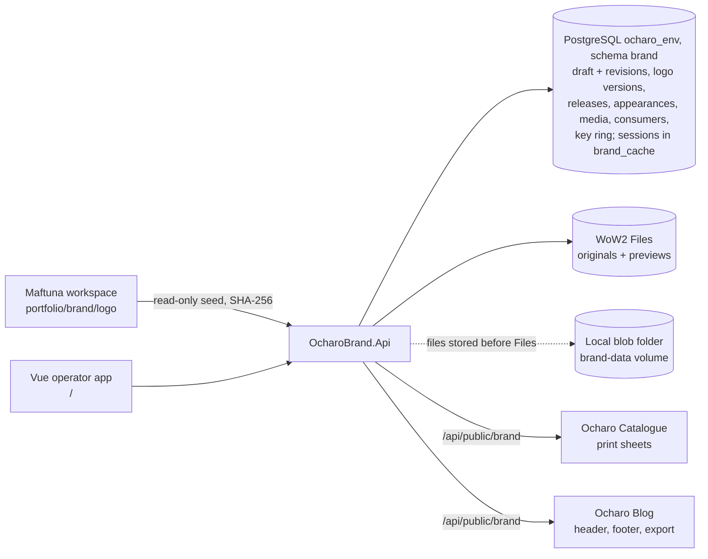

# ventures.ocharo-brand — Architecture

*Last updated: 2026-11-09*

| Project | Responsibility |
|---|---|
| `OcharoBrand.Api` | `BrandsController` and `PublicBrandsController` (dispatch through `ISender`), runtime config and system status, Identity BFF sign-in with sessions in the be sdk PostgreSQL cache and `BrandAccessMiddleware` (bound organization, `brand:edit`, `brand:approve`), response headers (CORS on `/api/public`), SDK problem details with Brand's 413/415/502/503 status mapper, seed-on-empty, the `import-sqlite` verb and the 503 while the retired SQLite store waits for it |
| `OcharoBrand.Application` | Commands and queries (identity, logo versions, publish, appearances, consumers, public kit, media), their models, the `IBrandRepository`/`IMediaStore` contracts and the `BrandErrors` catalogue |
| `OcharoBrand.Domain` | `BrandDraft`, `BrandIdentity` (localized text, palette, typography, links), `LogoVersion`, `BrandRelease`, `BrandAppearance`, records |
| `OcharoBrand.Infrastructure` | Command and query handlers; `BrandDraftService` (draft view, publish diff) and `PublicBrandService` (kit build, logo fallbacks, disclosure, appearance boundaries); `MediaStore` (kit `IBlobRepository`, SkiaSharp WebP previews), `FilesMediaStore`, `BrandSeeder` |
| `OcharoBrand.Persistence` | EF Core over PostgreSQL schema `brand` (snake_case), owned by the bespoke SQL `brand` migration set (`Migrations/001-baseline`); draft saves check the expected revision and write a snapshot, a write that loses a race answers 409; the Data Protection key ring table; `Import/` copies the retired SQLite store once, verified |

## Contracts

- `GET /api/public/brand?locale=uz|ru|en&app={name}` — latest release plus any active appearance: `{ name, spellingRule, release, publishedAt, locale, descriptor, tagline, location, descriptors, palette[], typography, links[], logos{slot: {url, fileUrl, previewUrl, contentType, width, height, sha256, fromAppearance, fileId}}, appearance }`; cached 60 s.
  Bare (no `{ data }` envelope); a null member is omitted, as in every Brand response (be sdk JSON), so `appearance`, `fileId`
  and empty texts may be absent.
- Cache lifetimes of the kit, stable logo URLs and tokens are capped at the next appearance start/end, so no cache outlives a scheduled change.
- `GET /api/public/brand/releases/{n}` — a pinned release (no appearance applied).
- `GET /api/public/brand/logo/{slot}[?preview=true]` — stable logo URL that always serves the current file (5-min cache + ETag).
- `GET /api/public/brand/media/{sha}[/preview]` — immutable, content-addressed files (1-year cache), served only once disclosed: part of a published release or of an appearance that has started. Draft uploads and future appearance artwork return 404 publicly (a hash is not confidentiality); the admin app reads them through `/api/brand/media/{sha}`.
- `GET /api/public/brand/tokens.css` — `--ocharo-{key}` colour variables plus font stacks.
- Consumers identify themselves with `X-Ocharo-App` or `?app=`; the overview lists them with the release they last read.
- Editing API under `/api/brand/*` answers `{ data }` and fails with SDK problem details (`brandCode` names a Brand
  refusal). It is revision-checked (`expectedRevision`, 409 on conflict) and needs a signed-in
  member of `Brand:OrganizationId`: writes `brand:edit`, publish and withdraw `brand:approve`, every unsafe request
  `X-Csrf-Token` (Ocharo's Identity, 2026-11-03).
- `GET /api/runtime-config` — anonymous, `no-store`: the suite's `OCHARO_*_URL` app links from the optional `OcharoApps:*`
  settings (Desk, Catalogue, Studio, Marketing, Editorial, Brand, Atlas, Wear, Blog). Only absolute HTTPS values without
  credentials, query or fragment are served; startup logs one warning naming every rejected setting.
- `GET /api/system/status` — anonymous, `no-store`: `{ service, status: "live", version }`. It, `/health` (the be sdk's,
  with the PostgreSQL readiness check) and runtime config are exempt from the Ocharo SSO boundary; with SSO off they stay
  behind the pilot boundary like every other route.

## Storage

- One `ocharo_{env}` database per environment, shared with Desk, Identity and Studio; Brand owns schema `brand` (its
  `brand` set, `brand_migration_history`, advisory lock `8262001`) and `brand_cache` (the be sdk's `distributed_cache`
  set). The deploy's `migrate` step applies both; a deployed boot only verifies their levels, a local run applies them.
- Brand binds one organization by setting and stores no organization or account id, so its set keys into no Identity
  table and declares no dependency on it.
- Documents (draft, revision snapshots, logo versions, releases, appearances) stay text, byte for byte as written;
  instants are `timestamptz` in UTC.
- The SQLite store retired on 2026-11-09: `import-sqlite` copies it once per environment and refuses on any divergence
  (`../../deployment/brand/brand.md` § PostgreSQL move).

## Operator frame

The SPA wears the Ocharo suite frame, as Desk and Catalogue do
([suite agreement](../../../../../docs/architecture.md#suite-frame-and-app-links)):

- `bootstrap/AppLayout.vue`, mounted through a layout route, holds every place; Brand has no public SPA route. The
  route's guard awaits the Identity BFF session (SDK `createBffStrategy` and `AuthProvider`) and sends a visit without
  one to sign-in; an unknown path opens a not-found place inside the frame.
- First paint: `index.html` links the Ocharo symbol as the tab icon (ink, reverse for a dark tab strip) and the app tile
  as `apple-touch-icon.png`, and carries the static twin of the SDK `SplashScreen` (wordmark and bar), which lifts once
  the session and the first place settle.
- Top bar: the SDK `AppSwitcherMenu` (current `brand`, the "O" mark), the app version, the breadcrumb from route
  metadata, the release the draft stands on with Refresh, and the SDK `AccountMenu` last — appearance, the Brand and API
  versions, the person Identity names (name, then email or phone; else "Signed in to Ocharo") and sign-out.
- Sidebar (SDK `SidebarMenu`, rail state in `ocharo.brand.sidebar-collapsed`): Overview, Identity, Logos and Appearances,
  then Connect under Admin. Phones get the SDK `BottomNavMenu` with the first four and a full-screen More dialog.
- App links resolve runtime config first, then build-time `VITE_OCHARO_*_URL`, then the local-run defaults; a malformed
  served value drops that app and raises one toast. Brand reads its own kit same-origin and needs no other address.
- Colour: the SDK `ocharo` theme through `ColorModeProvider` and the generated pre-paint `/theme.js`, key
  `ocharo.brand.theme`. The logo proof surfaces (`--color-artwork-*`: paper `#f8f7f3`, ink `#20211e`, transparency check
  `#e6e2d8`/`#fffdf8`) and palette swatches are artwork colours and never follow the interface mode.
- Glass: the top bar, sidebar, menus and phone bar take the theme's glass strength through the SDK (`variant="glass"`,
  `variant="glass-menu"`, `surface-glass`, `border-glass-edge`); Brand keeps no glass copy of its own.
- Language: frame copy uses English message keys with Uzbek and Russian entries; the interface stays Uzbek because the
  pages are still Uzbek literals, so the account menu shows no language rows until the pages are localized. The apps
  menu names Editorial by the suite's `Apps menu: Editorial` key, apart from the writing-style word.

## Consumers

- Catalogue print sheets fetch the kit in the browser (logo file + links; catalogue contact lines that repeat a brand handle are dropped).
- Blog fetches the kit on the server (`Blog:BrandBaseUrl`), copies the logo into its own media store by SHA-256 and uses the brand links; an unreachable Brand service keeps the blog's own settings.

## SDK usage and extraction candidates

- Uses the published kit `WoW2.Sdk.Beta.Be 10.0.106-beta` (host and API defaults, mediator with `AppResult`, problem details and error mapping, controller JSON, blob storage, validated settings) and `@wow-two-beta/fe 0.0.41` (HTTP client, BFF session strategy and auth provider, session-bound query client, config, router and guard, error boundary, splash, icons, colour mode, Ocharo theme and glass, app shell, app switcher, account menu, sidebar and bottom nav, buttons, cards, badges and form fields).
- Candidates for SDK extraction (shared with Catalogue/Blog): revisioned document store, content-addressed media store with previews, local-pilot boundary middleware, a generic "published kit" client with cache + fallback.
