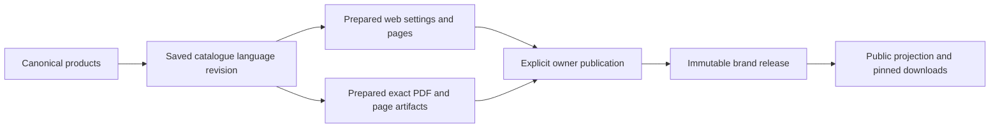

# Catalogue authoring and outputs

*Last updated: 2026-10-20*

## Current review target

The user corrected the active target to **Ocharo Catalogue**, frontend `8282` and API HTTPS
`8278`. Native Catalogue now contains the gallery, product review and Web/PDF designers.
Read [native Catalogue verification](../research/catalogue/2026-10-01-catalogue-review/native-catalogue-verification.md) for the current review instructions.
The Desk architecture/results below remain historical implementation evidence, not instructions
to redirect Catalogue review into Desk. Existing Catalogue product data was retained. Authentication
and consolidation of the two stores remain explicit integration work; no migration occurred here.

## Ownership and entrypoints

Ocharo Desk owns authenticated products, catalogue authoring, preparation and publication.
One saved `DesignDocument` represents one catalogue in one content language. Its immutable
revisions hold the catalogue metadata, independent web pages and fixed PDF pages. There is
no second mutable catalogue or product database for this feature.

| Surface | Current entrypoint and owner |
|---|---|
| Canonical gallery | `/catalogue` resolves the authenticated workspace; `/organizations/{organizationId}/catalogue` lists its designs. |
| Canonical editor | The gallery opens `?design={id}&mode=web` or `?design={id}&mode=pdf`; optional `page` selects a page. |
| Canonical products | `/organizations/{organizationId}/products`; products own names, materials, translated copy, prices, review questions and media groups. |
| Retained Catalogue pilot | Preserved `ocharo-catalogue.*` applications retain their earlier local data/API. Their banner opens Desk in a new tab, preserving unsaved pilot work. They are not another canonical editing path. |
| Public catalogue | Marketing consumes the explicitly published Platform release through `/api/public/v1/brands/{slug}/catalogue?locale={locale}`. |

The checked-in Desk frontend defaults to HTTPS port **8378**, proxying API port **8264**.
Environment overrides and an IDE session can use other ports. These defaults do not establish
that a service is running. The retained pilot bridge (`resolveCatalogueDeskUrl`) defaults to
`https://localhost:8264/catalogue`. The Ocharo app menu's Desk link is Desk's root address from runtime config
`OCHARO_DESK_URL` (build-time `VITE_OCHARO_DESK_URL`). Both accept only an HTTPS destination without credentials,
query or fragment. No automatic redirect discards the older editor's state.

## Saved catalogue contract

The additive `snapshot.catalogue` contains:

- `slug`, `description`, `isActive` and `outputs: { web, pdf }`.
- `web: { theme, pages }`, with `editorial` or `grid` theme.
- Ordered web pages: `id`, `title`, `layout`, `isActive`, `productIds`.
  Layouts are `spread`, `grid` or `collage`.

Existing `snapshot.pages` remain the fixed PDF canvases. Their optional `isActive` defaults
to true. Web and PDF page ordering, layout and activation are independent. A web-only catalogue
can save without PDF pages. Empty drafts can be saved; preparing an output requires usable pages.
Older snapshots without `catalogue` retain their PDF-only behavior.

The gallery reads a summary projection containing title, locale, timestamps and catalogue metadata
with active page counts. It does not download every full editor snapshot. Metadata changes, activation,
duplication and removal use the saved document's expected revision. Removal archives the working
document; saved history and earlier releases remain available.

Slugs use 1–100 lowercase letters/numbers separated by single hyphens. Reserved application paths
are unavailable. Prepared editions are unique by **brand + slug + locale**. A different saved document
cannot take over that combination. Drafts can temporarily share a slug; preparation enforces ownership.
Preparing a renamed document replaces its current named entry while immutable release history stays intact.

## Product and language boundary

The interface supports Uzbek, Russian and English independently of the catalogue's 25-language
authoring registry. A product is eligible in a selected catalogue language only when it is active,
that exact language's copy is approved, and it has no open review questions. Missing translations
remain missing; another language never becomes an implicit replacement.

Product review questions (`Tekshiruv savollari`) are explicit source/editorial questions. They are
separate from each language's confirmation state. The product editor exposes confirmation and
unresolved-copy indicators; confirming one language does not confirm its siblings.

Brand and product references are validated within the authenticated organization. New named designs
must connect their product references to a canonical brand. Preparing an edition rechecks the current
brand products. Old designs retain their earlier page-level brand checks.

| Output | Eligibility behavior |
|---|---|
| Web | Omit inactive pages; remove unconfirmed/inactive products from each page; omit pages left empty. Confirmed siblings remain visible. |
| PDF | Omit inactive pages and the entire page if any referenced product is ineligible. Cover/editorial pages without product references can remain. |
| Previously prepared PDF | If referenced product approval changes, the binary PDF is withheld in a later release until re-prepared. Safe web siblings can still be projected. |

PDF eligibility includes references on the page, its canonical source and bound elements. Uploads
must contain exactly the full PDF plus PNG/PDF artifacts for the selected fixed pages. A web-only
preparation sends metadata without files. The server does not rewrite an uploaded PDF to remove products.

## Copy, prices and media

Products remain the source of product facts, translated material/name/description text and prices.
The saved design owns shared catalogue labels, header/footer, collection copy and price-display choices.
For PDF pages, explicit refresh copies canonical values into the saved layout; product changes do not
rewrite an immutable saved design behind the editor.

Edited product prices use **UZS** with exactly two tiers: **1–9 pieces** and **10+ pieces**. The same
canonical UZS amounts apply to every content language. Price edits reset their confirmation in the
editor. Existing unchanged legacy prices and historical releases are preserved; source adoption has
an explicit server-side preservation path. Existing foreign-currency values are never relabelled or
converted to UZS automatically. Public prices require their separate confirmed state.

Prepared web output preserves:

- Theme, selected media group and all five price-display flags.
- Exact selected-language shared copy, using the existing core-language defaults when no override exists.
  Additional-language shared copy starts empty apart from the brand header.
- Selected product image hashes in canonical group order. Only approved, non-reference media qualifies.
- Confirmed price tiers from the release's canonical products; the legacy single retail-price field remains compatible.

Image groups are product-owned references, categorized as model, product, detail or fabric. An explicit
group cannot import another product's image. Public projection checks approval and product membership
again, so a private image cannot become visible through an old selection. The separate active-image
upload/removal/minimum-count proposal remains queued.

## Preparation, release and history

Preparing attaches a backend-owned, initially unapproved edition to a brand draft. Publication by
edition ID is explicit owner action and creates an immutable brand release. Saving a product, changing
catalogue activity or archiving a design does not silently replace an earlier public release.

- Prepare: `POST /api/organizations/{organizationId}/brands/{brandId}/commerce/catalogue-editions`.
- Publish named edition: `POST .../commerce/catalogue-editions/{editionId}/publish`.
- The older language-based publication route selects the legacy unnamed edition only.
- Public `catalogues[]` contains active, approved named editions in the requested language, with
  independent nullable `web` and `pdf` outputs. Available-language lists describe eligible released
  versions, not every supported authoring language.
- Existing public `edition` and PDF asset routes remain compatible. Asset URLs are pinned to a release;
  withdrawal makes that release unavailable. Web-only editions have no PDF asset.

## Sources

| Concern | Implementation |
|---|---|
| Document and summary models | [DesignDocumentSummary.cs](../codebase/brand-workspace.backend-services/BrandWorkspace.Domain/DesignDocuments/Models/DesignDocumentSummary.cs) |
| Metadata and references | [CatalogueDefinition.cs](../codebase/brand-workspace.backend-services/BrandWorkspace.Application/Commerce/CatalogueDefinition.cs) |
| Preparation and selected artifacts | [CatalogueEditionBuilder.cs](../codebase/brand-workspace.backend-services/BrandWorkspace.Infrastructure/Commerce/CatalogueEditionBuilder.cs) |
| Web settings and approved image selection | [CatalogueWebSettings.cs](../codebase/brand-workspace.backend-services/BrandWorkspace.Application/Commerce/CatalogueWebSettings.cs) |
| Pricing and publication eligibility | [CommerceRules.cs](../codebase/brand-workspace.backend-services/BrandWorkspace.Application/Commerce/CommerceRules.cs) |
| Public response | [PublicProjection.cs](../codebase/brand-workspace.backend-services/BrandWorkspace.Application/Commerce/PublicProjection.cs) |
| Gallery and separate designers | [CatalogueGalleryPage.vue](../codebase/brand-workspace.frontend-services/apps/web/src/presentation/workspace/CatalogueGalleryPage.vue), [CatalogueWorkspacePage.vue](../codebase/brand-workspace.frontend-services/apps/web/src/presentation/workspace/CatalogueWorkspacePage.vue) |
| Canonical navigation | [EditorNavigation.ts](../codebase/brand-workspace.frontend-services/apps/web/src/domain/workspace/EditorNavigation.ts) |
| Retained pilot bridge | [OcharoApps.ts](../codebase/ocharo-catalogue.frontend-services/apps/web/src/domain/shared/OcharoApps.ts), [CatalogueDeskEntry.vue](../codebase/ocharo-catalogue.frontend-services/apps/web/src/presentation/common/CatalogueDeskEntry.vue) |

## Verification boundary

Backend evidence for this implementation:

| Executed gate | Result |
|---|---|
| Backend compile with `BuildSpa=false` | Passed, zero warnings/errors |
| Unit suite after final output-eligibility refinement | 80 passed |
| Complete API E2E suite before final output-eligibility refinement | 101 passed |
| Affected catalogue API E2E suite after that refinement | 22 passed |

The API tests used disposable PostgreSQL containers and test accounts. They cover named web-only
preparation, multiple same-language catalogues, summary projection, publication by ID, stale approval,
private downloads, membership/tenant boundaries and compatibility. Unit cases cover mixed PDF-page
exclusion, surviving web siblings, malformed metadata, selected copy/media and fixed-price edits.
Logs for this run are in `/tmp/ocharo-catalogue-review/`; they are local execution evidence.

No live brand publication was performed. User-owned IDE services were not restarted by this lane.
Owner review remains open in the [version track](../planning/version-track/v0.1/v0.1.md).
