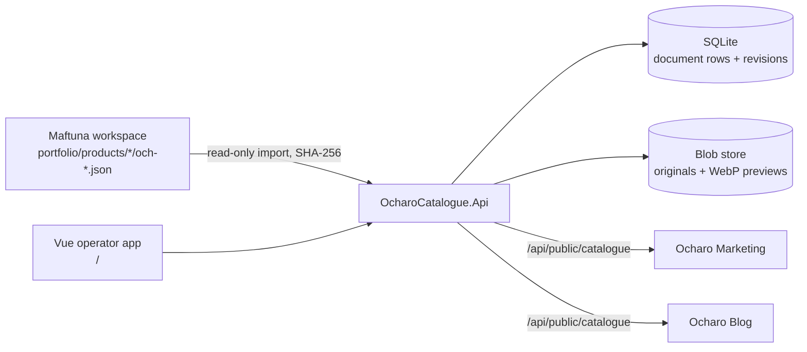

# ventures.ocharo-catalogue — Architecture

*Last updated: 2026-10-20*

> Retained local-pilot architecture. Canonical authenticated authoring and named web/PDF editions
> are documented in [Catalogue authoring and outputs](../catalogue-outputs.md). The pilot remains
> preserved and offers an explicit Desk link; its local data is not a second canonical write path.
> The older runtime examples below describe that retained implementation, not the current Desk entrypoint.

| Project | Responsibility |
|---|---|
| `OcharoCatalogue.Api` | Controllers, local-pilot boundary (loopback, no cross-origin writes), ProblemDetails mapping, seed-on-empty |
| `OcharoCatalogue.Application` | `ProductService` (validation, revisions, bulk status/prices), `CollectionService`, `SettingsService`, `PublicCatalogueService`, `CatalogueExportService` |
| `OcharoCatalogue.Domain` | `ProductDocument` (locales, pricing tiers, media, review issues, provenance), `CollectionDocument`, `CatalogueSettings`, records |
| `OcharoCatalogue.Infrastructure` | `MediaStore` (kit `IBlobRepository`, SkiaSharp WebP previews), `WorkspaceCatalogueImporter` |
| `OcharoCatalogue.Persistence` | EF Core SQLite; saves check the expected revision inside a transaction and write a snapshot |

## Contracts

- `GET /api/public/catalogue?locale=uz|ru|en` — `{ brand, currency, locale, generatedAt, priceNote, garmentTypes, collections[], products[] }`; products carry copy for the requested locale plus all locales, pricing tiers, and image URLs (`/api/catalogue/media/{sha}` + `/preview`).
- Media URLs are content-addressed and immutable (1-year cache).
- Editing API under `/api/catalogue/*` is loopback-only and revision-checked (`expectedRevision`, 409 on conflict).
- Stock: `GET /api/catalogue/products/stock`, `PUT /api/catalogue/products/{id}/stock` `{ expectedRevision, stock: {size: pieces} | null, madeToOrder }`; the public feed adds `availability` and `availableSizes` only.
- Copy grid: `GET /api/catalogue/products/copy`, `PUT /api/catalogue/products/{id}/copy` `{ expectedRevision, locales }` — replaces only the three-language copy.
- `GET /api/runtime-config` — anonymous, `no-store`, public values only: the `OcharoApps:{Desk,Catalogue,Studio,Marketing,Editorial,Brand,Atlas,Wear,Blog}` settings as `OCHARO_*_URL` keys, the same keys Desk serves. A value that is not an absolute HTTPS address without credentials, query or fragment is left out, with one startup warning naming the setting.
- `GET /api/system/status` — anonymous, `no-store`: `{ service, status, version }` with the informational version. `GET /api/system/version` stays for existing callers.
- With SSO enabled, `/c`, `/api/public`, `/api/catalogue/media`, `/health`, `/api/system/version`, `/api/system/status` and `/api/runtime-config` stay reachable without a session.

## Brand

- Print sheets read Ocharo Brand's public kit from the Brand API (`OCHARO_BRAND_API_URL`, build `VITE_OCHARO_BRAND_API_URL`, local `https://localhost:8286/`): the published on-light logo file replaces the text wordmark, and brand links lead the contact lines (catalogue lines that repeat a brand handle are dropped). Brand offline → text wordmark + catalogue contact lines. The app menu's Brand link is the separate Brand app address (`OCHARO_BRAND_URL`, local `https://localhost:8288/`).

## Frame

- Every authoring route renders inside `bootstrap/AppLayout.vue`, mounted through a layout route: the suite's glass top bar (Ocharo app button with the app version, breadcrumb from route metadata, notifications, SDK `AccountMenu`), a sidebar of Catalogues, Collections, Products, Stock and Admin › Settings that collapses to an icon rail, and a phone bottom bar with More. The published reader `/c/{slug}` keeps its own header and limited Settings dialog.
- Prices, product copy and the print sheet are retained product-wide tools under Products; they stay out of the sidebar because the product editor and the PDF designer supersede them.
- App menu addresses resolve at startup through the SDK config seam: `/api/runtime-config`, then `VITE_OCHARO_*` build values, then local defaults.
- The SDK `ocharo` theme (`theme-ocharo` on `<html>`) supplies every colour; `ColorModeProvider` keeps the stored appearance under `ocharo.catalogue.theme` and `/theme.js` applies it before first paint.

## SDK usage and extraction candidates

- Uses the published kit `WoW2.Sdk.Beta.Be 10.0.71-beta` (blob storage, mediator registration) and `@wow-two-beta/fe 0.0.28` (HTTP client, router, config, colour mode, Ocharo theme, app shell, app switcher, account menu, sidebar and bottom navigation, error boundary, icons).
- Product-local candidates for later SDK extraction: revisioned document store (document row + snapshot + expected-revision save), content-addressed media store with previews, local-pilot boundary middleware, CSV formula-safe writer, lazily resolved SQLite/blob paths.
