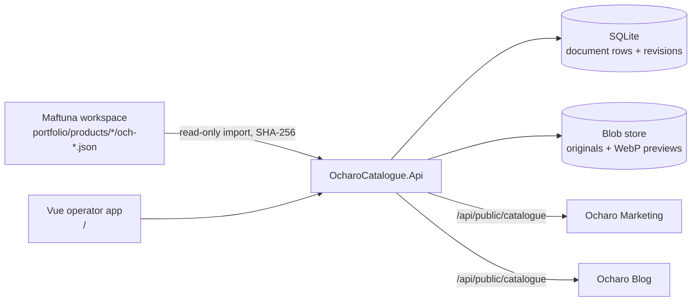

# ventures.ocharo-catalogue — Architecture

*Last updated: 2026-11-09*

> Retained local-pilot architecture. Canonical authenticated authoring and named web/PDF editions
> are documented in [Catalogue authoring and outputs](../catalogue-outputs.md). The pilot remains
> preserved and offers an explicit Desk link; its local data is not a second canonical write path.
> The older runtime examples below describe that retained implementation, not the current Desk entrypoint.

| Project | Responsibility |
|---|---|
| `OcharoCatalogue.Api` | Controllers that dispatch through `ISender` only, one per resource under `Catalogue/{Products,Collections,Settings,Media,Designs,Publishing,Importing,Exporting}/`; local-pilot boundary (no cross-origin writes); `CatalogueErrorHttpStatusCodeMapper`; seed-on-empty |
| `OcharoCatalogue.Application` | Contracts only: commands, queries and models per subdomain (`Catalogue/Products/`, `Collections/`, `Settings/`, `Media/`, `Designs/`, `Publishing/`, `Importing/`, `Exporting/`), with `Core/` holding `CatalogueErrors`, the stored-JSON options and the repository contracts |
| `OcharoCatalogue.Domain` | `ProductDocument` (locales, pricing tiers, media, review issues, provenance), `CollectionDocument`, `CatalogueSettings`, records |
| `OcharoCatalogue.Infrastructure` | The mediator handlers (`CommandHandlers/`, `QueryHandlers/`) and the foundation services, mappers, policies and validators they share, per subdomain; `MediaStore` and `FilesMediaStore`, the release asset stores, `WorkspaceImportService` |
| `OcharoCatalogue.Persistence` | EF Core SQLite; saves check the expected revision inside a transaction and write a snapshot; `SqliteBusyExceptionMappingRule` |

## Contracts

- `GET /api/public/catalogue?locale=uz|ru|en` — `{ brand, currency, locale, generatedAt, priceNote, garmentTypes, collections[], products[] }`; products carry copy for the requested locale plus all locales, pricing tiers, and image URLs (`/api/catalogue/media/{sha}` + `/preview`). This feed keeps its frozen wire shape — unenveloped, null fields written (`PublicFeedJson`) — because Marketing's catalogue sync reads `pricing` and `retail` without checking they exist; Blog reads it too.
- Every other JSON endpoint answers the SDK wire: the success payload under `{ data }` (`ApiResponse<T>`), SDK JSON (camelCase, null fields left out), and failures as SDK problem details from `AppErrorProblemDetailsFactory` (`type` `urn:wow-two:error:{Type}`, `code`, `detail`, trace ids). Dictionary keys stay as stored (size labels, language codes, runtime-config names). An upload too large answers 413, one in an unaccepted format 415, a call WoW2 Files refused 502; a busy SQLite store 409.
- Media URLs are content-addressed and immutable (1-year cache).
- Editing API under `/api/catalogue/*` is revision-checked (`expectedRevision`, 409 on conflict) and loopback-only on a local
  run; a deployed host serves it publicly without sign-in until the identity server lands (`Catalogue:PublicAccess`,
  owner decision 2026-10-24).
- Stock: `GET /api/catalogue/products/stock`, `PUT /api/catalogue/products/{id}/stock` `{ expectedRevision, stock: {size: pieces} | null, madeToOrder }`; the public feed adds `availability` and `availableSizes` only.
- Copy grid: `GET /api/catalogue/products/copy`, `PUT /api/catalogue/products/{id}/copy` `{ expectedRevision, locales }` — replaces only the three-language copy.
- `GET /api/runtime-config` — anonymous, `no-store`, public values only: the `OcharoApps:{Desk,Catalogue,Studio,Marketing,Editorial,Brand,Atlas,Wear,Blog}` settings as `OCHARO_*_URL` keys, the same keys Desk serves. A value that is not an absolute HTTPS address without credentials, query or fragment is left out, with one startup warning naming the setting.
- `GET /api/system/status` — anonymous, `no-store`: `{ service, status, version }` with the informational version. `/health` is the be sdk's, with the database readiness check.
- With SSO enabled, `/c`, `/api/public`, `/api/catalogue/media`, `/health`, `/api/system/status` and `/api/runtime-config` stay reachable without a session.

## Brand

- Print sheets read Ocharo Brand's public kit from the Brand API (`OCHARO_BRAND_API_URL`, build `VITE_OCHARO_BRAND_API_URL`, local `https://localhost:8286/`): the published on-light logo file replaces the text wordmark, and brand links lead the contact lines (catalogue lines that repeat a brand handle are dropped). Brand offline → text wordmark + catalogue contact lines. The app menu's Brand link is the separate Brand app address (`OCHARO_BRAND_URL`, local `https://localhost:8288/`).

## Frame

- Every authoring route renders inside `bootstrap/AppLayout.vue`, mounted through a layout route: the suite's glass top bar (Ocharo app button with the app version, breadcrumb from route metadata, notifications, SDK `AccountMenu`), a sidebar of Catalogues, Collections, Products, Stock and Admin › Settings that collapses to an icon rail, and a phone bottom bar with More. The published reader `/c/{slug}` keeps its own header and limited Settings dialog.
- The layout route's guard awaits the Identity BFF session (SDK `createBffStrategy` and `AuthProvider`) and sends a visit without one to sign-in; a failed sign-in's return or a session read the API did not answer opens the frame, which offers sign-in in another tab. The published reader reads no session: a visit that opens there reads it only when it enters the frame.
- First paint: `index.html` links the Ocharo symbol as the tab icon (ink, reverse for a dark tab strip) and the app tile as `apple-touch-icon.png`, and carries the static twin of the SDK `SplashScreen` (wordmark and bar), which lifts once the session and the first place settle (the reader waits for the place alone).
- Prices, product copy and the print sheet are retained product-wide tools under Products; they stay out of the sidebar because the product editor and the PDF designer supersede them.
- App menu addresses resolve at startup through the SDK config seam: `/api/runtime-config`, then `VITE_OCHARO_*` build values, then local defaults.
- The SDK `ocharo` theme (`theme-ocharo` on `<html>`) supplies every colour and the frame glass; `ColorModeProvider` keeps the stored appearance under `ocharo.catalogue.theme` and `/theme.js` applies it before first paint. The top bars, sidebar, menus, notifications and phone bar use the SDK glass variants and `surface-glass*` materials; the image controls over product photos read the theme's `--glass-fill`. Catalogue keeps no glass copy of its own.
- With an Ocharo session the account menu names the person Identity names (name, then email or phone; else "Signed in to Ocharo") and offers sign-out. The apps menu names Editorial by the suite's `Apps menu: Editorial` key, apart from the designer's Editorial style.
- Server reads the frame shares (the catalogue settings, the Brand kit) sit in the SDK query cache, bound to the session, so a sign-out or another person or organization clears them. Local state goes through the SDK storage seam: the interface language and a guest's saved pieces in `localStorage`, a designer's unsaved recovery copy in this tab's `sessionStorage`.

## SDK usage and extraction candidates

- Uses the published kit `WoW2.Sdk.Beta.Be 10.0.106-beta` (blob storage, mediator with `AppResult` and its exception-to-result interceptor, problem details, SDK JSON) and `@wow-two-beta/fe 0.0.41` (HTTP client, BFF session strategy and auth provider, session-bound query client, storage seam, router and guard, config, colour mode, Ocharo theme and glass, splash, app shell, app switcher, account menu and link rows, sidebar and bottom navigation, error boundary, icons, buttons, cards, badges and form fields).
- Product-local candidates for later SDK extraction: revisioned document store (document row + snapshot + expected-revision save), content-addressed media store with previews, local-pilot boundary middleware, CSV formula-safe writer, lazily resolved SQLite/blob paths, and the frontend's `sessionStorage` broker (`integration/common/SessionStorageBroker.ts`, the SDK ships only the `localStorage` one).
